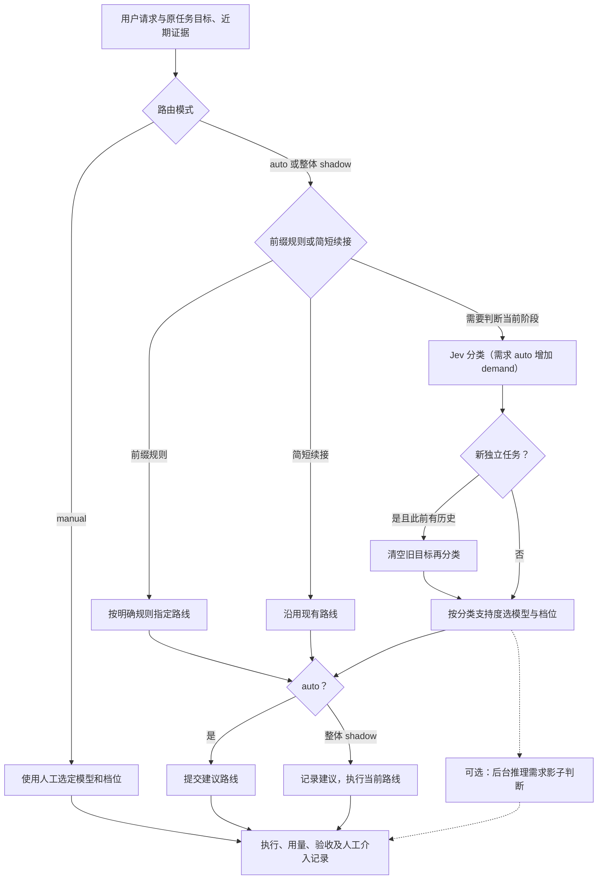

# 推理需求选档与路由成本记录

推理需求支持 `auto` 和 `shadow`。`auto` 将需求问题合入主分类请求，参与 low/medium/high 选档；`shadow` 继续用独立后台请求观察建议，不改变路线。省略时使用原有阶段策略。分类器继续使用配置中的 Jev，模型选择规则保持不变。

`auto` 按当前阶段需要的推理选择档位：常规任务 low，多步骤任务 medium，复杂推理 high。总体方案已定但实施仍需筛选规则、消解冲突、划定边界并验证这些决定是否一致，可以属于复杂推理；普通跨来源核对或按确定规则逐项实现属于多步骤任务。不因技能名称、文件数量或输入长度自动升档。

现有诊断、架构、未明根因和敏感逻辑的 high 要求继续作为最低档；明确实施至少 medium。需求支持度不足时沿用原档，指代不清或缺少关键条件时不降档。模型与需求分别判定，complex 不自动改用专家。`auto` 策略记录带 `-demand-v1` 后缀，需求答案、实际支持度及 `effortDecision` 随 accepted 保存；分类失败和缺失需求答案仍走现有显式失败与原档保留流程。

## 影子模式与观测记录

1. **独立判断推理需求。** 新问卷区分 `routine`（按明确对象、规则或方案做常规处理）、`multi_step`（前后依赖的检索、推导、计算和验证）、`complex`（探索候选路径、非直接可得的算法/证明、相互影响的约束）。分类支持度达到阈值后记录 low/medium/high 建议；该建议只表达推理需求，不包含敏感操作要求或专家模型选择。
2. **影子判断不改变当前选档。** 用冻结的实际分类上下文发起单独后台请求；基准五项问卷、置信度和输入预算不变。请求失败、超时或建议 high，都不会阻止主任务提交或改动执行路线。连接关闭时取消尚在运行的影子请求。
3. **分类成本可核查。** 每个决策有 `decisionId`，每次初次分类、新任务复判、影子调用有独立 `callId`，记录耗时、是否发起 HTTP、输入与问卷摘要、上下文版本及供应商 usage。分类失败后已返回的用量仍记录；未知输出/缓存/推理 token 保持 null。原生日志保存经过现有脱敏器处理的实际分类输入，供核查裁剪后的请求，不采集私有 reasoning。
4. **反馈能说明路由问题。** 成功的原生模型选择记录原/新路线及轮次。人工反馈可注明档位合适/不足/过强，以及因耗时、质量、token、容量或其他原因介入；还可记录人工推理需求标签。这些反馈不会自动更新规则。
5. **周报对照阶段、预测和成本。** 周报保留当前工作类型、影子需求分布、与实际档位的差异及人工需求标签一致数，差异只是审核线索，不自动算作质量错误。 基准分类与推理需求影子调用分别计数、计时、计 token，取消或未获原生接受的决策也计入已记录分类成本。原始提交到轮次完成的耗时包含分类及提交等待；执行耗时仍单列。旧记录缺少决策编号时，完整总 token 保持未知，不把旧分类成本算成零。

独立影子请求能避免新问题影响原来的五项预测。开启后，每个经过分类且得到有效选档的用户请求最多多一次 Jev 调用；前缀规则、简短续接和 manual 跳过。该额外成本单列，影子模式下这些建议不参与选档。当前测试验证隔离、记录和反馈行为，没有证明新问卷的人工标签准确率或执行质量收益。

## 开启与使用

配置的 `native` 中增加：

```json
"reasoningDemand": "shadow"
```

将值改为 `"auto"` 可让需求判断参与实际选档；省略时关闭需求问题。影子模式完整示例见 [native-reasoning-demand-shadow.json](../examples/native-reasoning-demand-shadow.json)。`auto` 在主请求中增加一题，不额外调用分类器；`shadow` 仍最多增加一次后台调用。该设置与整个会话的路由模式独立：整体 shadow 只记录建议，manual 保持手动路线。F8 切换的整个路由 auto/shadow/manual 模式另行控制实际选档。本机配置已设为需求 auto，新进程生效；从原项目目录正常退出再运行 `codex-fenjue resume --last`，已有进程不会热更新。

```sh
npm start -- feedback list
# 先隐藏预测，按该轮实际可见输入标注；提供真实 TASK_ID/TURN_ID。
npm start -- feedback add --task TASK_ID --turn TURN_ID --outcome rework \
  --reviewer light --cause reasoning --reason '需要交叉验证，遗漏了来源冲突' \
  --route-assessment insufficient --switch-cause quality --demand multi_step \
  --evidence '独立验收结果'
npm start -- feedback report --days 7 --out .fenjue/review/week.json
```

`--route-assessment` 可用 appropriate/insufficient/excessive；`--switch-cause` 可用 latency/quality/tokens/capacity/other；`--demand` 可用 routine/multi_step/complex。这些标签必须限定 `--turn`，避免把某一阶段的难度作为整个任务的标签。现有 outcome/cause/reviewer/reason/evidence 规则继续适用。盲标时先查看该轮输入和当时的证据，再看日志中的预测；不能用后续结果替此前补标签。

周报 JSON 的 `routing.classification`、`routing.demandShadow` 提供各自成本；`routing.unacceptedCalls` 显示未关联已接受决策的调用，`routing.missingDecisionIds` 显示所选执行轮次中没有新测量编号的数量。`summary.recordedTotalTurnMs` 是有起始时间记录的轮次总耗时，`summary.endToEndObservedTokens` 包含主执行、专家审查、基准分类与影子请求。多个后台请求可能并行，调用耗时之和不能当成用户实际等待时长；仍在运行或异常退出而未完成测量的请求以 pending 保留，耗时及用量保持未知；请求结束后以同一 callId 的完成记录替换。历史调用无用量时不追溯推算。

## 现有自动路由的整体逻辑



### 五项判断

| 维度 | 判断对象 | 对选档的影响 |
| --- | --- | --- |
| relation | 新任务、延续、纠正或指代不清 | 确定是否保留旧目标和路线参考；纠正并不自动等于升档 |
| scope | 局部、同项目多文件、跨独立系统 | 默认决定主模型或专家模型的倾向 |
| reasoning | 机械处理、实施、诊断、架构权衡 | 决定当前工作类型及推理档位倾向 |
| uncertainty | 条件充分、关键需求缺失、根因未知 | 根因未知提高 high 支持度；缺失指代/条件时保护此前档位 |
| consequence | 可逆、公开契约、敏感逻辑 | 敏感操作提高 high 支持度；机械且可逆才支持 low |

分类使用原任务目标与近期证据，预算不足时优先裁剪旧工具输出、保留目标与最新约束，并标记省略；不静默裁剪当前新请求。正常的阶段转换会重新判断：查明根因后实施修复按 solution，复杂工作完成后的摘要按当前机械阶段。`[new]` 明确开始新任务；不明确的新任务由 relation 的支持度识别，必要时用空旧目标再分类，避免旧复杂阶段污染新请求。

### 模型和 effort 分开选择

默认策略中，scope 的 local+multifile 支持度达到阈值就选择主模型；cross_system 达到阈值且配置了专家模型，就选择专家。没有专家配置时，只选择主模型的三个 effort。已有 `expertPolicy=constraints` 候选可改为依据耦合约束选专家，本版没有开启或改变它。

未开启需求 auto 时，档位使用原五项分类的概率支持度，本机阈值为 0.75：

- **high：** diagnosis+architecture、unknown_cause 或 sensitive 任一支持度达到阈值。
- **low：** mechanical 与 reversible 都有足够支持，且未知根因、敏感操作不妨碍常规处理。
- **medium：** mechanical+solution 有足够支持，但未满足 low；否则保留此前档位，首次请求默认主模型 medium。

模型支持度不足和档位支持度不足分别保留此前结果，不是所有维度都不变。指代不清或关键条件缺失时，不降低此前已接受的模型/档位；已明确进入实施阶段时，即使部分条件不确定，也不会从 low 留在低于实施所需的 medium。支持度不是任务成功率。

提交后实际采用的路线记录为 accepted。F8 或原生模型选档器可切为人工控制；容量不足单独依据后端明确错误处理，不作为“任务难度高”的标签。配置了专家审查时，重复测试失败可触发独立只读审查与主模型修正，这也是单独的质量路径。需求 auto 将需求答案纳入主分类用量；周报的 demandShadow 成本仍只统计独立影子请求。选档与显示的本地测试不证明真实分类准确率或执行质量收益，需继续用日常盲标及同起点、独立验收的执行对照核对。

## 后续校准

每周选 10–20 个完整案例，同时纳入普通成功/无反馈、人工介入、失败和阶段转换。先核对分类理解，再核对选档；每次只调整一个候选规则。用已有代码快照及独立验收比较质量、总耗时、token 和人工切档次数；冻结候选后，用未来时间窗口或新项目验证。人工标注和实测数据积累前，不自动训练或修改生产路由。

本版验证：干净发布副本 207 项测试通过，保留其他进行中修改的工作区 223 项测试通过；没有为新问卷发起真实模型评测。
